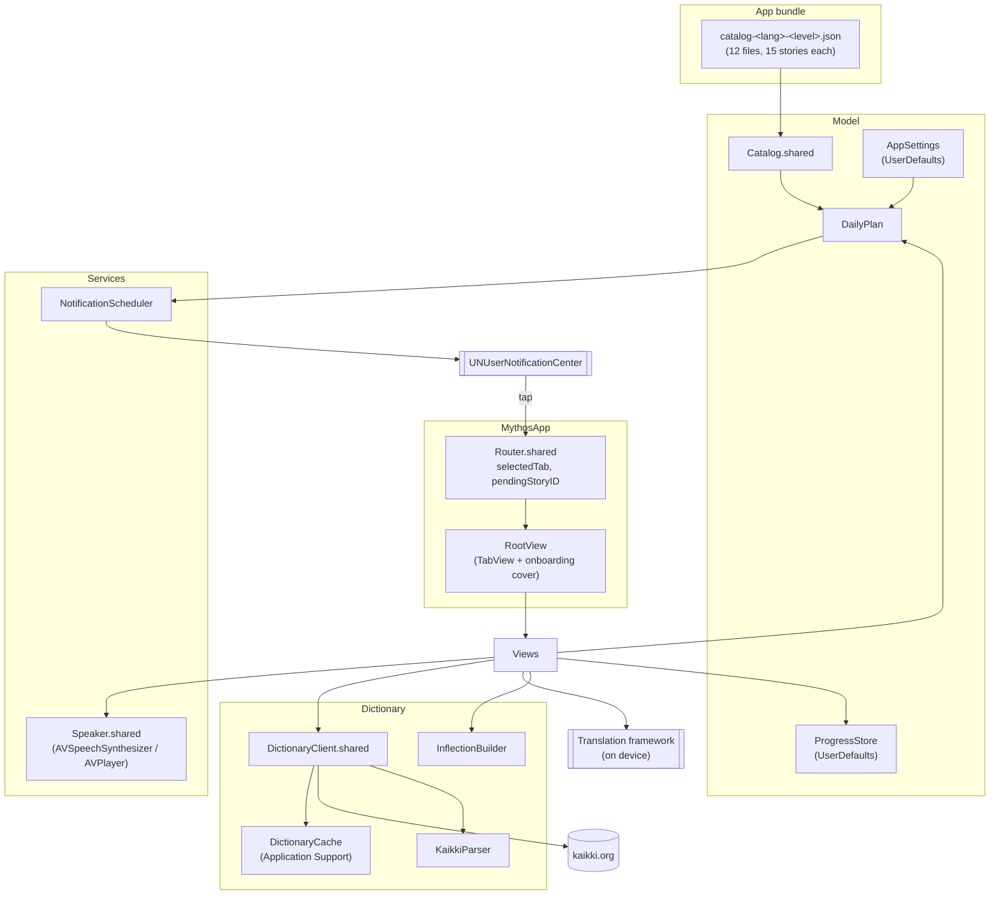
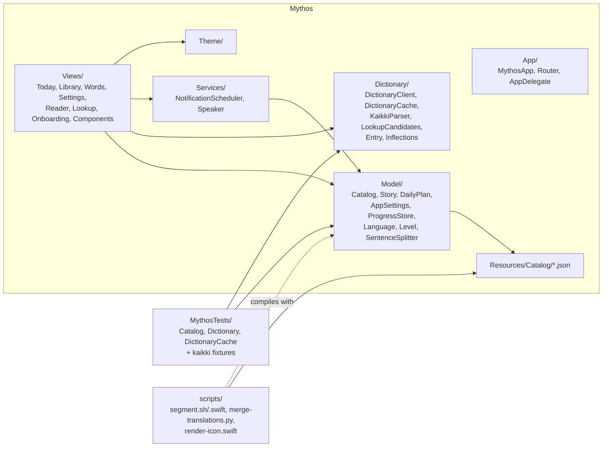
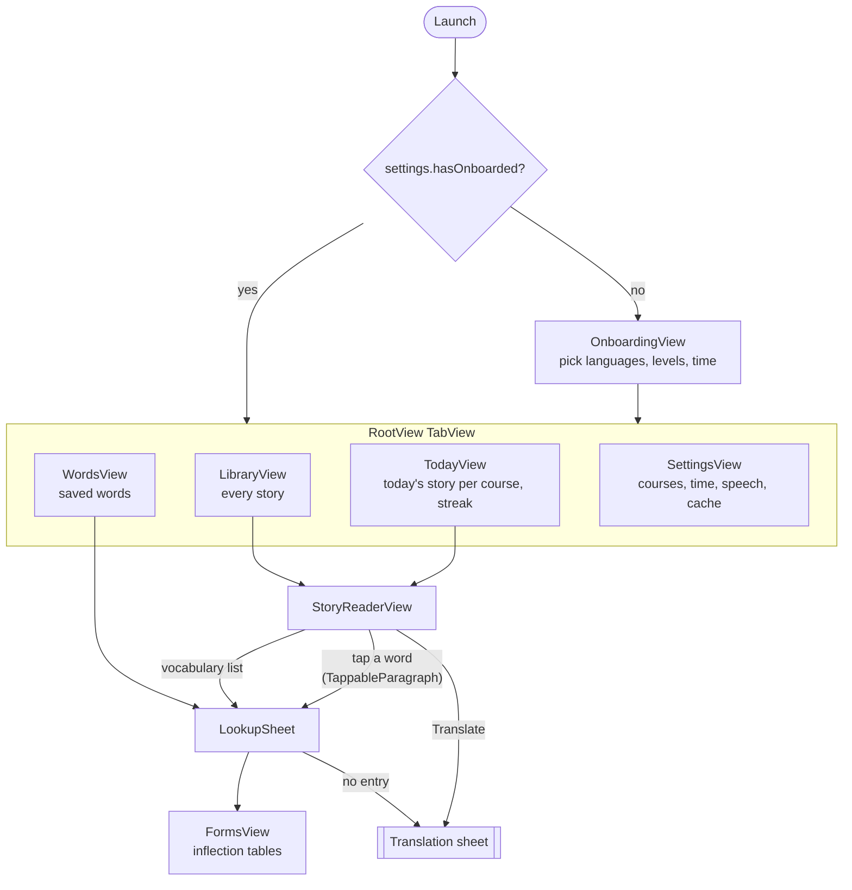
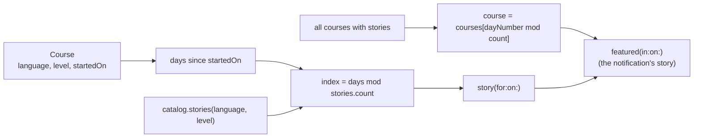
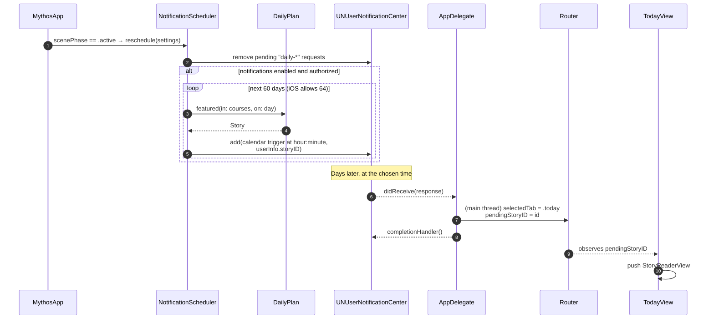
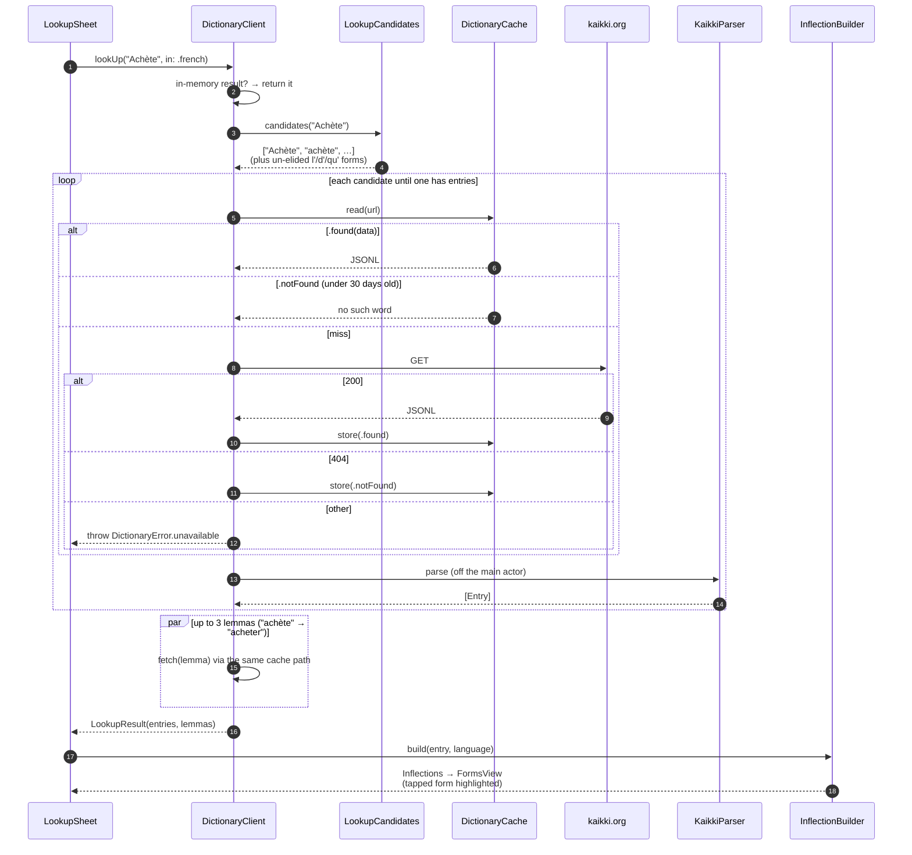
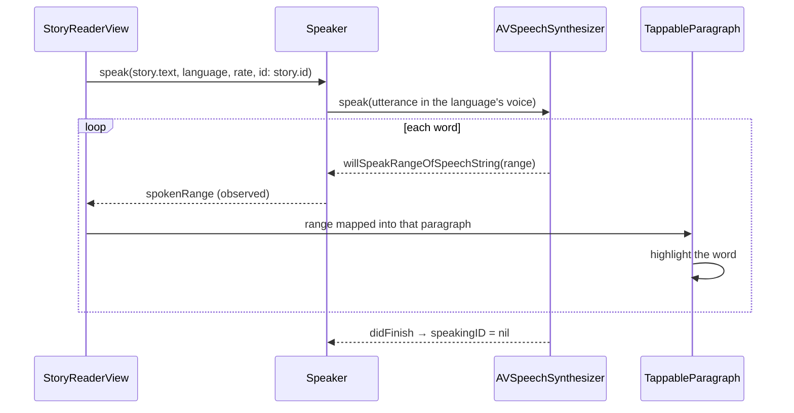
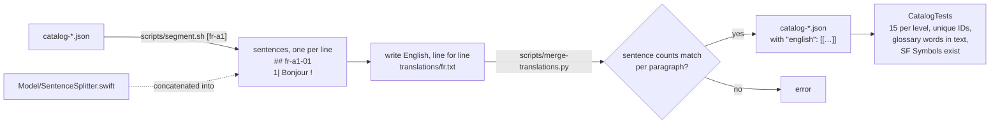
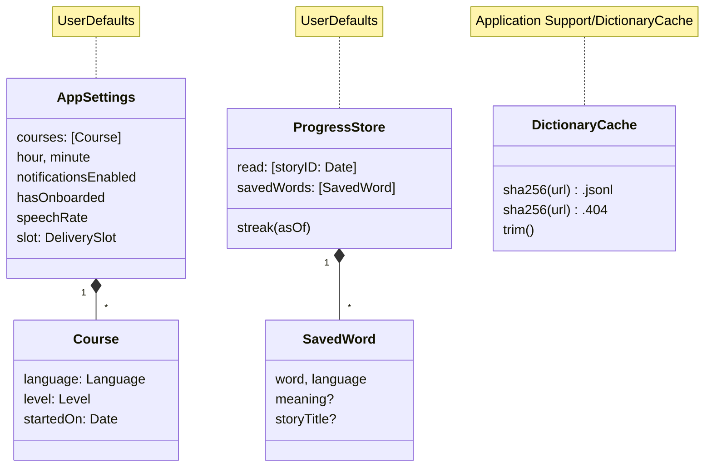

# How Mythos works

Diagrams of the app's structure and its main flows. For the feature list and
how to run it, see the [README](../README.md).

## The big picture

Everything runs on the phone. The only network calls go to kaikki.org for
dictionary lookups, and those are cached on disk.

`MythosApp` creates `AppSettings` and `ProgressStore` and passes them, with
`Router.shared` and `Speaker.shared`, down through the SwiftUI environment.

## Source layout

## Screens

## Which story is today's

`DailyPlan` is a pure function of the catalog, the courses and the date, so a
notification scheduled weeks ahead names the same story the app shows on that
day.

`Today` shows `story(for:on:)` for every course. Notifications use
`featured(in:on:)`, so with several languages they take turns day by day.

## Daily notifications

The Today banner asks for permission when it hasn't been asked yet
(`requestAuthorization`), or links to iOS Settings when it was refused.

## Looking a word up

The disk cache trims itself least recently used first, down to its budget
(`maxBytes`, 80 MB by default), in a background task when the client starts.

## Reading aloud

`story.text` joins paragraphs with a blank line (two UTF-16 units), which is
how the reader maps the spoken range back to a paragraph. Single words and
table forms go through `Speaker.play(url, fallback:)`, which plays the
Wiktionary recording when there is one.

## Catalog content and translations

The scripts use the app's own `SentenceSplitter`, so the English sentences
line up with the sentences the app shows them beside: `TranslationSection`, in
the reader under the story, pairs each sentence with its English via
`Story.sentencePairs`.

## State that persists

